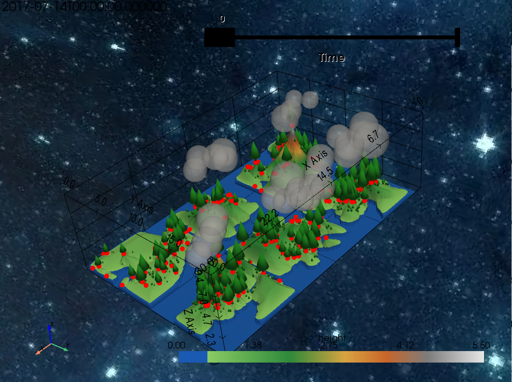
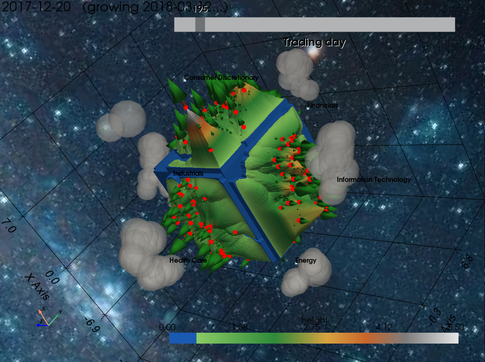

## About

This project was made during the WHACK hackathon at Warwick University, together with three other dedicated team-members. More information can be found at https://warwickhack.co.uk/

This project is about a creative approach to financial modeling. Instead of visualizing data with graphs, we thought to do it with planets where each property represents a different data. The terrain represents the volatility, the trees represent the stocks and the clouds represent the stock's beta compared with the market's. The world is seperated into six sectors, all of which correspond to a different financial sector and has the related companies located inside. The entire planets structure changes as the date of which the data takes place is modified by the slider, the data has been collected through wikipedia and pyfinance.

## Controls

'T' to toggle the trees, arrow keys to move the slider by one in the corresponding direction.

## Running

In order to run the system, the user needs to download the data by running the ```pipeline/fetch_data.py```, ```pipeline/get_market_caps.py``` and ```pipeline/volatility.py``` files. Make sure to run the volatility file last.

Then run ```2DT.py``` in order to generate the necessary numpy data structures for the visualization.

### Running the flat planet algorithm

Run the ```2DT_trees.py``` file.

### Running the cubic planet algorithm

Run the ```cube.py``` file, or the ```cube_non_cloud.py``` for a non-cloud version.

### Gallery




